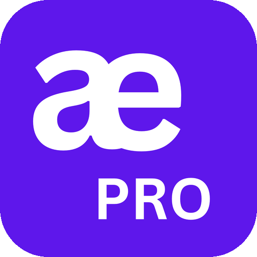

<div dir="rtl">

<div align="center">



# AEmulator Pro

**تقریباً هر فرم‌ور اندروید — HTC Sense، TouchWiz، MIUI، AOSP — را روی یک گوشی مدرن شبیه‌سازی کنید.** انشعابی از [AEmulator](https://github.com/uxazu/AEmulator) با امکانات و اصلاحات بیشتر.

[🇬🇧 English](../../README.md) · [🇷🇺 Русский](README.ru.md) · [🇺🇦 Українська](README.uk.md) · [🇩🇪 Deutsch](README.de.md) · [🇫🇷 Français](README.fr.md) · [🇪🇸 Español](README.es.md) · [🇧🇷 Português](README.pt-BR.md) · [🇮🇹 Italiano](README.it.md) · [🇵🇱 Polski](README.pl.md) · [🇹🇷 Türkçe](README.tr.md) · [🇸🇦 العربية](README.ar.md) · **🇮🇷 فارسی** · [🇮🇳 हिन्दी](README.hi.md) · [🇮🇩 Indonesia](README.id.md) · [🇻🇳 Tiếng Việt](README.vi.md) · [🇨🇳 简体中文](README.zh-CN.md) · [🇯🇵 日本語](README.ja.md) · [🇰🇷 한국어](README.ko.md)

</div>

---

AEmulator Pro یک ایمیج واقعی سیستم اندروید 1.0–17 را مستقیماً از فایل فرم‌وری که از قبل دارید بوت می‌کند. کد قدیمی ARM را با QEMU وصله‌شده ترجمه می‌کند، binder هسته را شبیه‌سازی می‌کند، با GPU گوشی شما رسم می‌کند و صدا را از طریق پشته صوتی اندروید پخش می‌کند — همه‌چیز داخل یک اپ معمولی. این پروژه تقریباً به‌طور کامل با Claude Sonnet 5.5 ساخته شد (و شبیه‌ساز اصلی با Opus 5.5).

## امکانات

- درون‌ریزی تقریباً هر قالب فرم‌ور: Android-x86 `.iso`، CWM/TWRP ZIP، Samsung Odin `.tar.md5`، Google factory `.tgz`، `system.img`، OTA `system.new.dat.br`، Motorola `.sbf`، ایمیج‌های sparse، ایمیج‌های EDL، Spreadtrum `.pac`، HTC `.nbh`، HTC `RUU.exe` و بسیاری قالب‌های دیگر
- پوسته‌های سازندگان در صورت سازگاری همان‌طور که هستند کار می‌کنند: HTC Sense، Samsung TouchWiz، MIUI، AOSP
- گرافیک سخت‌افزاری از طریق پل GL، صدا، لمس و چندلمسی، شبکه با پراکسی TLS مدرن
- پوشه مشترک کارت حافظه برای APKها، موسیقی و عکس‌ها
- **تم‌های صفحه ماشین مجازی و ویرایشگر تم**: نوار ناوبری و قاب اطراف صفحه مهمان از یک تم پیروی می‌کنند — Original، Sunset، Gingerbread 2.x، Honeycomb 3.x، Holo 4.x یا Lollipop 5.x — یا تم خودتان که در ویرایشگری با پیش‌نمایش زنده ساخته می‌شود (شکل و اندازه کلیدها، رنگ‌های نوار/کلید/فشار/قاب، درخشش و هاله، نوار شناور یا تخت، تصویر قاب، گوشه‌های گرد صفحه). تم‌ها را می‌توان به‌صورت فایل‌های `.aetheme` به اشتراک گذاشت. تنظیمات اپ  ظاهر  تم صفحه ماشین مجازی.
- **کتابخانه‌تان را مرتب کنید**: یک ROM را نگه دارید و برای جابه‌جایی به بالا یا پایین بکشید (فهرست کلاسیک و شبکه 0.0.0.3)، و ROMها را در پوشه‌های نام‌دار که باز و بسته می‌شوند گروه‌بندی کنید — یک ROM را روی پوشه رها کنید یا از منوی   انتقال به پوشه استفاده کنید
- رابط Material 3 Expressive به 19 زبان
- رایگان و متن‌باز (GPL-3.0)

## شروع سریع

1. APK را از [Releases](https://github.com/Joakso97/AEmulator-Pro/releases) دانلود و نصب کنید.
2. AEmulator Pro را باز کنید ← **افزودن فرم‌ور** و فایل را انتخاب کنید. درون‌ریزی چند دقیقه طول می‌کشد.
3. **شروع** را بزنید. بوت اول کندتر است: سیستم اپ‌هایش را بهینه می‌کند.
4. منوی  برای صدا، دکمه روشن/خاموش و گزارش‌هاست؛ دکمه  تنظیمات و زبان را باز می‌کند.

## نیازمندی‌ها

- اندروید 8.0+ روی گوشی ARM ۶۴ بیتی (arm64-v8a)
- حدود 1–3 گیگابایت فضای خالی برای هر فرم‌ور
- به دلیل چند مشکل با GPUهای Mali، پردازنده Snapdragon توصیه می‌شود

## ساخت از سورس

ساخت release آزمایش‌شده اپ از JDK 21 و Android SDK 36 استفاده می‌کند. به [دستورالعمل ساخت/سورس](../build-source.md) مراجعه کنید، شامل جزئیات زنجیره‌ابزار بومی و امضا.

```bash
git clone https://github.com/Joakso97/AEmulator-Pro.git
cd AEmulator-Pro
./gradlew copyReleaseApks
```

## قدردانی

AEmulator Pro از شبیه‌سازهای HTC Desire HD و HTC One M7 ساخته [نویسنده اصلی](https://t.me/istratiit_ech) رشد کرد — موتور او این پروژه را ممکن ساخت.

این یک انشعاب تغییریافته از [uxazu/AEmulator](https://github.com/uxazu/AEmulator) است که علاوه بر آن از بسیاری امکانات [drel4/AEmulator-Sunset](https://github.com/drel4/AEmulator-Sunset) استفاده می‌کند.

## پیوندها

- انشعاب من: [Joakso97/AEmulator-Pro](https://github.com/Joakso97/AEmulator-Pro)
- بالادست: [uxazu/AEmulator](https://github.com/uxazu/AEmulator)
- AEmulator-Sunset (قدردانی فراوان برای بسیاری از امکانات): [drel4/AEmulator-Sunset](https://github.com/drel4/AEmulator-Sunset)
- نویسنده: [somerandomusername2](https://github.com/somerandomusernam2)
- نویسنده اصلی: [t.me/istratiit_ech](https://t.me/istratiit_ech)

## مجوز

GPL-3.0. اندروید، علائم تجاری و فرم‌ورها متعلق به مالکان آن‌ها هستند.

به [اطلاعیه‌های تغییر تاریخ‌دار](../../NOTICE.md) و [ممیزی باز سورس/مجوز](../license-audit.md) مراجعه کنید. برچسب GPL گواهی نیست که هر فایل باینری همراه، سورس کامل متناظر دارد.

</div>
