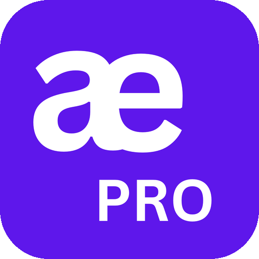

<div align="center">



# AEmulator Pro

**लगभग किसी भी Android फ़र्मवेयर — HTC Sense, TouchWiz, MIUI, AOSP — को आधुनिक फ़ोन पर एमुलेट करें।** [AEmulator](https://github.com/uxazu/AEmulator) का एक फ़ोर्क, अधिक सुविधाओं और सुधारों के साथ।

[🇬🇧 English](../../README.md) · [🇷🇺 Русский](README.ru.md) · [🇺🇦 Українська](README.uk.md) · [🇩🇪 Deutsch](README.de.md) · [🇫🇷 Français](README.fr.md) · [🇪🇸 Español](README.es.md) · [🇧🇷 Português](README.pt-BR.md) · [🇮🇹 Italiano](README.it.md) · [🇵🇱 Polski](README.pl.md) · [🇹🇷 Türkçe](README.tr.md) · [🇸🇦 العربية](README.ar.md) · [🇮🇷 فارسی](README.fa.md) · **🇮🇳 हिन्दी** · [🇮🇩 Indonesia](README.id.md) · [🇻🇳 Tiếng Việt](README.vi.md) · [🇨🇳 简体中文](README.zh-CN.md) · [🇯🇵 日本語](README.ja.md) · [🇰🇷 한국어](README.ko.md)

</div>

---

AEmulator Pro आपके पास पहले से मौजूद फ़र्मवेयर फ़ाइल से सीधे असली Android 1.0–17 सिस्टम इमेज बूट करता है। यह पुराने ARM कोड को पैच किए गए QEMU से अनुवादित करता है, कर्नेल के binder का अनुकरण करता है, आपके फ़ोन के GPU से चित्र बनाता है और Android के ऑडियो स्टैक से आवाज़ चलाता है — सब कुछ एक सामान्य ऐप के भीतर। यह प्रोजेक्ट लगभग पूरी तरह Claude Sonnet 5.5 से बनाया गया (और मूल एमुलेटर Opus 5.5 से)।

## सुविधाएँ

- लगभग हर फ़र्मवेयर प्रारूप आयात करें: Android-x86 `.iso`, CWM/TWRP ZIP, Samsung Odin `.tar.md5`, Google factory `.tgz`, `system.img`, OTA `system.new.dat.br`, Motorola `.sbf`, sparse इमेज, EDL इमेज, Spreadtrum `.pac`, HTC `.nbh`, HTC `RUU.exe` और कई अन्य
- निर्माता की skins संगत होने पर ज्यों की त्यों चलती हैं: HTC Sense, Samsung TouchWiz, MIUI, AOSP
- GL ब्रिज से हार्डवेयर ग्राफ़िक्स, ध्वनि, टच और मल्टीटच, आधुनिक TLS प्रॉक्सी के साथ नेटवर्क
- APK, संगीत और फ़ोटो के लिए साझा मेमोरी-कार्ड फ़ोल्डर
- **VM स्क्रीन थीम और थीम संपादक**: नेविगेशन बार और गेस्ट स्क्रीन के चारों ओर का फ़्रेम एक थीम का पालन करते हैं — Original, Sunset, Gingerbread 2.x, Honeycomb 3.x, Holo 4.x या Lollipop 5.x — या आपकी अपनी, जो लाइव पूर्वावलोकन वाले संपादक में बनाई जाती है (कुंजी के आकार और माप, बार/कुंजी/दबाव/फ़्रेम के रंग, चमक और प्रभामंडल, तैरती या सपाट बार, फ़्रेम चित्र, गोल स्क्रीन कोने)। थीम `.aetheme` फ़ाइलों के रूप में साझा की जा सकती हैं। ऐप सेटिंग्स  रूप  VM स्क्रीन थीम।
- **अपनी लाइब्रेरी व्यवस्थित करें**: किसी ROM को दबाकर रखें और क्रम बदलने के लिए ऊपर या नीचे खींचें (क्लासिक सूची और 0.0.0.3 ग्रिड), और ROM को नामित फ़ोल्डरों में समूहित करें जो खुलते-बंद होते हैं — ROM को फ़ोल्डर पर छोड़ें या उसके  मेनू  फ़ोल्डर में ले जाएँ का उपयोग करें
- 19 भाषाओं में Material 3 Expressive इंटरफ़ेस
- मुफ़्त और ओपन सोर्स (GPL-3.0)

## त्वरित शुरुआत

1. [Releases](https://github.com/Joakso97/AEmulator-Pro/releases) से APK डाउनलोड करें और इंस्टॉल करें।
2. AEmulator Pro खोलें  **फ़र्मवेयर जोड़ें** और फ़ाइल चुनें। आयात में कुछ मिनट लगते हैं।
3. **स्टार्ट** दबाएँ। पहला बूट धीमा होता है: सिस्टम अपने ऐप्स को अनुकूलित करता है।
4. वॉल्यूम, पावर बटन और लॉग के लिए  मेनू उपयोग करें;  बटन ऐप सेटिंग्स और भाषा खोलता है।

## आवश्यकताएँ

- 64-बिट ARM फ़ोन पर Android 8.0+ (arm64-v8a)
- प्रति फ़र्मवेयर लगभग 1–3 GB खाली जगह
- Mali GPU की कई समस्याओं के कारण Snapdragon SoC की सिफ़ारिश की जाती है

## स्रोत से बिल्ड

ऐप का परीक्षण किया गया release बिल्ड JDK 21 और Android SDK 36 उपयोग करता है। [बिल्ड/स्रोत निर्देश](../build-source.md) देखें, जिसमें नेटिव टूलचेन और हस्ताक्षर का विवरण शामिल है।

```bash
git clone https://github.com/Joakso97/AEmulator-Pro.git
cd AEmulator-Pro
./gradlew copyReleaseApks
```

## श्रेय

AEmulator Pro [मूल लेखक](https://t.me/istratiit_ech) के HTC Desire HD और HTC One M7 एमुलेटर से विकसित हुआ — उनके इंजन ने यह प्रोजेक्ट संभव बनाया।

यह [uxazu/AEmulator](https://github.com/uxazu/AEmulator) का संशोधित फ़ोर्क है, जो अतिरिक्त रूप से [drel4/AEmulator-Sunset](https://github.com/drel4/AEmulator-Sunset) की कई सुविधाएँ उपयोग करता है।

## लिंक

- मेरा फ़ोर्क: [Joakso97/AEmulator-Pro](https://github.com/Joakso97/AEmulator-Pro)
- अपस्ट्रीम: [uxazu/AEmulator](https://github.com/uxazu/AEmulator)
- AEmulator-Sunset (कई सुविधाओं के लिए बहुत-बहुत श्रेय): [drel4/AEmulator-Sunset](https://github.com/drel4/AEmulator-Sunset)
- लेखक: [somerandomusername2](https://github.com/somerandomusernam2)
- मूल लेखक: [t.me/istratiit_ech](https://t.me/istratiit_ech)

## लाइसेंस

GPL-3.0. Android, ट्रेडमार्क और फ़र्मवेयर उनके मालिकों के हैं।

[दिनांकित संशोधन सूचनाएँ](../../NOTICE.md) और [लंबित स्रोत/लाइसेंस ऑडिट](../license-audit.md) देखें। GPL लेबल इसकी प्रमाणिकता नहीं है कि हर बंडल किए गए प्रीबिल्ट के पास पूर्ण संगत स्रोत है।
