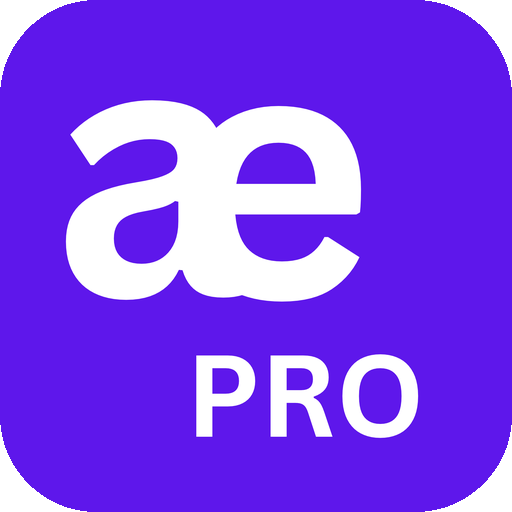

<div align="center">



# AEmulator Pro

**Neredeyse her Android firmware'ini — HTC Sense, TouchWiz, MIUI, AOSP — modern bir telefonda öykünün.** Daha fazla özellik ve düzeltme içeren bir [AEmulator](https://github.com/uxazu/AEmulator) çatalı.

[ English](../../README.md) · [ Русский](README.ru.md) · [ Українська](README.uk.md) · [ Deutsch](README.de.md) · [ Français](README.fr.md) · [ Español](README.es.md) · [ Português](README.pt-BR.md) · [ Italiano](README.it.md) · [ Polski](README.pl.md) · ** Türkçe** · [ العربية](README.ar.md) · [ فارسی](README.fa.md) · [ हिन्दी](README.hi.md) · [ Indonesia](README.id.md) · [ Tiếng Việt](README.vi.md) · [ 简体中文](README.zh-CN.md) · [ 日本語](README.ja.md) · [ 한국어](README.ko.md)

</div>

---

AEmulator Pro, zaten sahip olduğunuz bir firmware dosyasından gerçek bir Android 1.0–17 sistem görüntüsünü doğrudan başlatır. Eski ARM kodunu yamalı bir QEMU ile çevirir, çekirdeğin binder'ını öykünür, telefonunuzun GPU'su ile çizer ve sesi Android'in ses yığını üzerinden çalar — hepsi normal bir uygulamanın içinde. Bu proje neredeyse tamamen Claude Sonnet 5.5 ile yapıldı (ve özgün emülatör Opus 5.5 ile).

## Özellikler

- Neredeyse her firmware biçimini içe aktarır: Android-x86 `.iso`, CWM/TWRP ZIP, Samsung Odin `.tar.md5`, Google factory `.tgz`, `system.img`, OTA `system.new.dat.br`, Motorola `.sbf`, sparse görüntüler, EDL görüntüler, Spreadtrum `.pac`, HTC `.nbh`, HTC `RUU.exe` ve daha birçokları
- Üretici arayüzleri uyumluysa olduğu gibi çalışır: HTC Sense, Samsung TouchWiz, MIUI, AOSP
- GL köprüsü üzerinden donanım grafikleri, ses, dokunma ve çoklu dokunma, modern TLS proxy'si ile ağ
- APK'lar, müzik ve fotoğraflar için paylaşılan hafıza kartı klasörü
- **VM ekran temaları ve tema düzenleyici**: gezinme çubuğu ve konuk ekranının çevresindeki çerçeve bir temayı izler — Original, Sunset, Gingerbread 2.x, Honeycomb 3.x, Holo 4.x veya Lollipop 5.x — ya da canlı önizlemeli düzenleyicide yaptığınız kendi temanızı (tuş şekilleri ve boyutu, çubuk/tuş/basma/çerçeve renkleri, parıltı ve hale, yüzen veya düz çubuk, çerçeve resmi, yuvarlatılmış ekran köşeleri). Temalar `.aetheme` dosyaları olarak paylaşılabilir. Uygulama ayarları  Görünüm  VM ekran teması.
- **Kitaplığınızı düzenleyin**: bir ROM'a basılı tutun ve yeniden sıralamak için yukarı veya aşağı sürükleyin (klasik liste ve 0.0.0.3 ızgarası), ROM'ları açılıp kapanan adlandırılmış klasörlerde gruplayın — bir ROM'u klasörün üzerine bırakın veya  menüsü  Klasöre taşı'yı kullanın
- 19 dilde Material 3 Expressive arayüzü
- Ücretsiz ve açık kaynak (GPL-3.0)

## Hızlı başlangıç

1. APK'yı [Releases](https://github.com/Joakso97/AEmulator-Pro/releases) sayfasından indirin ve kurun.
2. AEmulator Pro'yu açın  **Firmware ekle** ve dosyayı seçin. İçe aktarma birkaç dakika sürer.
3. **Başlat**'a basın. İlk açılış daha yavaştır: sistem uygulamalarını optimize eder.
4.  menüsü ses, güç düğmesi ve günlükler içindir;  düğmesi ayarları ve dili açar.

## Gereksinimler

- 64 bit ARM telefonda Android 8.0+ (arm64-v8a)
- Firmware başına yaklaşık 1–3 GB boş alan
- Mali GPU'larla ilgili çeşitli sorunlar nedeniyle Snapdragon SoC önerilir

## Kaynaktan derleme

Test edilen uygulama release derlemesi JDK 21 ve Android SDK 36 kullanır. Yerel araç zinciri ve imzalama ayrıntıları dahil [derleme/kaynak talimatlarına](../build-source.md) bakın.

```bash
git clone https://github.com/Joakso97/AEmulator-Pro.git
cd AEmulator-Pro
./gradlew copyReleaseApks
```

## Katkıda bulunanlar

AEmulator Pro, [özgün yazarın](https://t.me/istratiit_ech) HTC Desire HD ve HTC One M7 emülatörlerinden doğdu — onun motoru bu projeyi mümkün kıldı.

Bu, [uxazu/AEmulator](https://github.com/uxazu/AEmulator)'un değiştirilmiş bir çatalıdır ve ayrıca [drel4/AEmulator-Sunset](https://github.com/drel4/AEmulator-Sunset)'ten birçok özellik kullanır.

## Bağlantılar

- Çatalım: [Joakso97/AEmulator-Pro](https://github.com/Joakso97/AEmulator-Pro)
- Upstream: [uxazu/AEmulator](https://github.com/uxazu/AEmulator)
- AEmulator-Sunset (birçok özellik için büyük teşekkürler): [drel4/AEmulator-Sunset](https://github.com/drel4/AEmulator-Sunset)
- Yazar: [somerandomusername2](https://github.com/somerandomusernam2)
- Özgün yazar: [t.me/istratiit_ech](https://t.me/istratiit_ech)

## Lisans

GPL-3.0. Android, ticari markalar ve firmware sahiplerine aittir.

[Tarihli değişiklik bildirimlerine](../../NOTICE.md) ve [süren kaynak/lisans denetimine](../license-audit.md) bakın. GPL etiketi, paketlenen her ikilinin eksiksiz eşleşen kaynağa sahip olduğunun sertifikası değildir.
